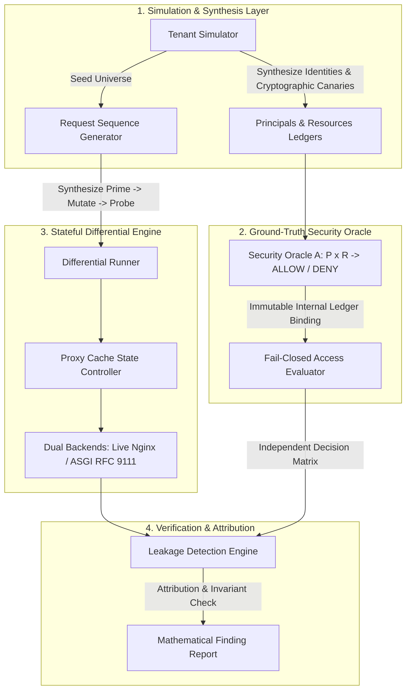

# TenantCache: Automated Differential Verification of Cache Isolation in Multi-Tenant Web Applications

<p align="center">
  
  
  
  
  
  
  
  
  
</p>

---

## Table of Contents

- [1. Executive Summary & Problem Formulation](#1-executive-summary--problem-formulation)
  - [The Edge-Origin Semantic Disconnect](#the-edge-origin-semantic-disconnect)
  - [Why Existing Vulnerability Scanners Fail (100% Blind Spot)](#why-existing-vulnerability-scanners-fail-100-blind-spot)
- [2. Research Contribution Taxonomy](#2-research-contribution-taxonomy)
- [3. Formal Model & Invariant Foundations](#3-formal-model--invariant-foundations)
  - [Coupled State Machines ($\Sigma_{\text{auth}} \times \Sigma_{\text{cache}}$)](#coupled-state-machines)
  - [The Confidentiality Invariant & Cryptographic Canaries](#the-confidentiality-invariant--cryptographic-canaries)
- [4. System Architecture](#4-system-architecture)
  - [Three-Phase Differential Execution Sequence](#three-phase-differential-execution-sequence)
  - [Evaluated Reverse-Proxy Archetypes ($V_1$–$V_6$, $S_1$–$S_2$)](#evaluated-reverse-proxy-archetypes)
- [5. Empirical Benchmark Results](#5-empirical-benchmark-results)
  - [Matched-Budget Comparison (198 Requests per Tool)](#matched-budget-comparison)
  - [Capability Evaluation Across All 8 Archetypes](#capability-evaluation-across-all-8-archetypes)
  - [Component Ablation Study & Category Confusion Matrices](#component-ablation-study)
  - [Multi-Seed Deterministic Reproducibility](#multi-seed-deterministic-reproducibility)
- [6. Real Native Nginx Integration](#6-real-native-nginx-integration)
- [7. Production Hardening Blueprint ($S_1$ & $S_2$)](#7-production-hardening-blueprint)
- [8. Quickstart & Reproduction Guide](#8-quickstart--reproduction-guide)
  - [Installation](#installation)
  - [Replication Commands](#replication-commands)
- [9. Project Repository Index](#9-project-repository-index)
- [10. Citation & Academic Provenance](#10-citation--academic-provenance)

---

## 1. Executive Summary & Problem Formulation

Modern cloud-native Software-as-a-Service (SaaS) applications predominantly utilize **multi-tenant architectures**, where underlying compute, database, and network caching layers are shared across logically segregated corporate customers (**Tenants**). To satisfy strict sub-millisecond latency requirements and reduce origin database load, web architectures interpose HTTP reverse-proxy caches (e.g., Nginx, Varnish, Cloudflare) at the network edge.

### The Edge-Origin Semantic Disconnect

However, a fundamental architectural friction exists between multi-tenancy and shared HTTP caching:

```
┌──────────────────────────────────────────────────────────────────────────────────┐
│                             THE CACHE ISOLATION GAP                              │
└──────────────────────────────────────────────────────────────────────────────────┘

   CLIENT A (Tenant 1)                   REVERSE PROXY CACHE                  ORIGIN APP SERVER
         │                                      │                                     │
         ├─── 1. GET /api/v1/dashboard ────────>│                                     │
         │    Authorization: Token_A            ├─── 2. Fetch from origin (MISS) ────>│
         │                                      │                                     │ [Evaluates RBAC]
         │                                      │<── 3. HTTP 200 OK (Confidential) ───┤ [Embeds Tenant A Data]
         │                                      │    Stores under synthetic key:      │
         │                                      │    hash("GET/api/v1/dashboard")     │
         │<── 4. Deliver Tenant A Dashboard ────┤                                     │
         │                                      │                                     │
   CLIENT B (Tenant 2)                          │                                     │
         │                                      │                                     │
         ├─── 5. GET /api/v1/dashboard ────────>│                                     │
         │    Authorization: Token_B            │ [Matches same synthetic key!]       │ [NEVER CONSULTED]
         │                                      │ [Cache HIT!]                        │
         │<── 6. LEAK: Serves Tenant A Data! ───┤                                     │
```

1. **Authorization is Origin-Centric:** Access control policies (RBAC, ABAC, row-level tenant security) execute inside application code and database queries.
2. **Caching is Edge-Centric:** Reverse proxies evaluate cache hits using minimal HTTP request attributes:
   $$\text{CacheKey} = \text{hash}(\text{Method}, \text{Scheme}, \text{Host}, \text{URI})$$
3. **The Isolation Failure:** When an authenticated endpoint returns confidential tenant or user data without strictly isolating cache keys by verified identity context, or without forbidding shared caching (`Cache-Control: private, no-store`), **Tenant B receives Tenant A's private response directly from the proxy cache without the application server ever being consulted**.

### Why Existing Vulnerability Scanners Fail (100% Blind Spot)

Conventional security tools suffer from structural limitations when addressing multi-state cache isolation:
- **Stateless DAST (e.g. ZAP, Burp Scanner):** Evaluates individual endpoints without coordinating temporal cache lifecycles ($S_{\text{cold}} \to S_{\text{warm}}$). Probing requests do not prime the proxy cache under an authorized peer identity.
- **Authorization Scanners (e.g. Autorize, AuthMatrix):** Replay tokens on individual endpoints while explicitly instructing proxies to bypass caching (`Cache-Control: no-cache`, randomized query nonces) to prevent stale responses.
- **Stateful REST Fuzzers (e.g. RESTler):** Model API producer-consumer relationships, but target origin web servers directly, treating intermediate proxy caches as transparent transport channels.

**Under equal request budgets (198 requests), conventional stateless testing achieves 0.0000 Recall ($[0.00, 0.08]$ CI)**. TenantCache bridges this divide by formally unifying stateful cache lifecycle orchestration with independent ground-truth authorization oracles.

---

## 2. Research Contribution Taxonomy

In alignment with rigorous academic standards, TenantCache's contributions are delineated into three distinct tiers:

1. **Engineering Integration:** Integrating RFC 9111 HTTP caching semantics, Nginx reverse-proxy configuration models, deterministic ASGI simulation, and cryptographic canary taint tracking into an automated, verifiable testing framework.
2. **Proposed Testing Methodology:** Formally coupling the temporal transitions of two independent state machines—the origin database authorization state $\Sigma_{\text{auth}}$ and the proxy cache state $\Sigma_{\text{cache}}$—combined with an independent ground-truth security oracle $\mathcal{A}(P, R, Q) \in \{\text{ALLOW}, \text{DENY}\}$ that detects confidentiality violations decoupled from HTTP status codes.
3. **Experimentally Proven Improvements:** Demonstrating that stateful differential verification eliminates the 100% false-negative blind spot of stateless scanners, detects temporal revocation lag, and suppresses false alarms on legitimately shared public assets ($FPR = 0\%$) under equal request budgets.

---

## 3. Formal Model & Invariant Foundations

### Coupled State Machines

We model the system under test as a composition of two asynchronous state machines:

1. **Origin Authorization State ($\Sigma_{\text{auth}}$):**
   $$\sigma_{\text{auth}} = \langle \mathcal{U}, \mathcal{T}, \mathcal{R}, \mathcal{M}, \mathcal{L} \rangle$$
   where $\mathcal{U}$ is the set of user identities, $\mathcal{T}$ is the tenant set, $\mathcal{R}$ is the resource catalog, $\mathcal{M}$ represents role bindings, and $\mathcal{L}$ is the authoritative access ledger.
2. **Proxy Cache State ($\Sigma_{\text{cache}}$):**
   $$\sigma_{\text{cache}} = \langle \mathcal{K}, \mathcal{V}, \tau \rangle$$
   where $\mathcal{K} \to \mathcal{V}$ maps cache keys $k = \kappa(req)$ to cached response representations $v = \langle \text{Status}, \text{Headers}, \text{Body} \rangle$, and $\tau: \mathcal{K} \to \mathbb{R}^+$ denotes time-to-live expiration.

### The Confidentiality Invariant & Cryptographic Canaries

Let $\mathcal{P}$ denote the set of principals $P = (T_P, U_P, R_P)$, $\mathcal{R}$ denote the set of resources $R = (T_R, \text{Owner}_R, \text{Visibility}_R, \mathcal{C}_R)$, and $\mathcal{A}: \mathcal{P} \times \mathcal{R} \times \mathcal{Q} \to \{\text{ALLOW}, \text{DENY}\}$ denote an independent ground-truth authorization function.

We formalize the cache confidentiality invariant as:

$$\forall P \in \mathcal{P}, \forall R \in \mathcal{R}, \forall S \in \mathcal{S}_{\text{cache}}: \quad \mathcal{A}(P, R, Q) = \text{DENY} \implies \mathcal{C}_R \cap \text{Tokens}(\text{Body}(\text{Resp}(P, Q_R, S))) = \emptyset$$

where $\mathcal{C}_R$ is the cryptographically unique canary token set embedded in resource $R$, and $\text{Resp}(P, Q_R, S)$ is the observed HTTP response served by the proxy cache under state $S$.

---

## 4. System Architecture



### Three-Phase Differential Execution Sequence

TenantCache evaluates endpoints by driving state transitions across three phases:
1. **Phase 1: Prime State ($S_{\text{cold}} \to S_{\text{warm}}$):** An authorized principal $P_1$ requests resource $R$, priming the reverse proxy cache.
2. **Phase 2: State Mutation (Optional):** An administrative event revokes $P_1$'s permission or alters ACLs in $\Sigma_{\text{auth}}$.
3. **Phase 3: Probe & Invariant Verification ($S_{\text{warm}}$):** A target principal $P_2$ requests $R$. The detector evaluates whether $P_2$ receives $P_1$'s cached canary payload when $\mathcal{A}(P_2, R) = \text{DENY}$.

### Evaluated Reverse-Proxy Archetypes

TenantCache provides reference implementations and test configurations for eight reverse-proxy caching archetypes:

| Archetype | Identifier | Cache Key / Policy Formula | Failure Mechanism | Defense Posture |
| :--- | :--- | :--- | :--- | :---: |
| **$V_1$** | `MISSING_TENANT_KEY` | `$scheme$request_method$host$request_uri` | Omission of tenant context; cross-tenant collision | **VULNERABLE** |
| **$V_2$** | `MISSING_USER_AUTH` | `$scheme$request_method$host$request_uri$tenant` | Omission of user identity; intra-tenant privilege leak | **VULNERABLE** |
| **$V_3$** | `UNVALIDATED_HEADER` | `$scheme$request_method$host$request_uri$http_x_tenant_id` | Trusting unauthenticated client header; spoofing leak | **VULNERABLE** |
| **$V_4$** | `STALE_REVOCATION` | Stale cache retention without active invalidation | Inaccessible representation served after permission revocation | **VULNERABLE** |
| **$V_5$** | `ERRONEOUS_PUBLIC` | `proxy_ignore_headers Cache-Control;` | Shared caching forced across private endpoints | **VULNERABLE** |
| **$V_6$** | `NORMALIZATION` | `$scheme$request_method$host$uri` | Unnormalized path; `//` collapses to `/` causing collision | **VULNERABLE** |
| **$S_1$** | `STRICT_PRIVATE` | `proxy_cache_bypass $http_authorization;` | Authenticated requests unconditionally bypass cache | **SECURE** |
| **$S_2$** | `IDENTITY_KEYED` | `$scheme$method$host$uri|$auth_tenant|$auth_user` | Server-verified `auth_request` subrequest with per-request ACL check | **SECURE** |

---

## 5. Empirical Benchmark Results

Evaluated across the canonical **Dataset v1.1** benchmark corpus (66 unique scenarios: 46 positive vulnerability cases, 20 balanced negative controls, spanning 5 enterprise tenants, 10 user principals, and 27 resources).

### Matched-Budget Comparison

To ensure rigorous evaluation fairness, all methodologies were tested under an identical request budget of **198 requests** (3 requests per scenario):

| Testing Approach | Cache Archetype | Requests | Resets | TP | FP | TN | FN | Precision (95% Wilson CI) | Recall (95% Wilson CI) | Specificity (95% Wilson CI) | False Positive Rate |
|---|---|:---:|:---:|:---:|:---:|:---:|:---:|:---:|:---:|:---:|:---:|
| **Baseline A (Stateless DAST)** | `V1` | 198 | 66 | 0 | 0 | 20 | 46 | *N/A (Undefined)* | **0.0000** `[0.00, 0.08]` | **1.0000** `[0.84, 1.00]` | **0.0000** `[0.00, 0.16]` |
| **Baseline B (Naive Diffing)** | `V1` | 198 | 66 | 38 | 12 | 8 | 8 | **0.7600** `[0.63, 0.86]` | **0.8261** `[0.69, 0.91]` | **0.4000** `[0.22, 0.61]` | **0.6000** `[0.39, 0.78]` |
| **TenantCache (Proposed)** | `V1` | 198 | 66 | 46 | 0 | 20 | 0 | **1.0000** `[0.92, 1.00]` | **1.0000** `[0.92, 1.00]` | **1.0000** `[0.84, 1.00]` | **0.0000** `[0.00, 0.16]` |

*Baseline Scoping Note:* Baselines A and B represent custom reference implementations designed to evaluate specific algorithmic properties: stateless single-request probing (without cache-state sequencing) and naive length/token differential testing (without an independent authorization oracle). They do not evaluate commercial enterprise DAST suites operating under custom multi-user automation scripts.

### Capability Evaluation Across All 8 Archetypes

| Methodology | Cache Archetype | Scenarios | TP | FP | TN | FN | Precision (95% CI) | Recall (95% CI) | Specificity (95% CI) | Accuracy (95% CI) | Duration |
|---|---|:---:|:---:|:---:|:---:|:---:|:---:|:---:|:---:|:---:|:---:|
| **Baseline A** | `V1_MISSING_TENANT_KEY` | 66 | 0 | 0 | 20 | 46 | *N/A* | 0.0000 `[0.00, 0.08]` | 1.0000 `[0.84, 1.00]` | 0.3030 `[0.21, 0.42]` | 0.46s |
| **Baseline B** | `V1_MISSING_TENANT_KEY` | 66 | 38 | 12 | 8 | 8 | 0.7600 `[0.63, 0.86]` | 0.8261 `[0.69, 0.91]` | 0.4000 `[0.22, 0.61]` | 0.6970 `[0.58, 0.79]` | 0.60s |
| **TenantCache** | `V1_MISSING_TENANT_KEY` | 66 | 46 | 0 | 20 | 0 | **1.0000** `[0.92, 1.00]` | **1.0000** `[0.92, 1.00]` | **1.0000** `[0.84, 1.00]` | **1.0000** `[0.94, 1.00]` | 0.60s |
| **TenantCache** | `V2_MISSING_USER_AUTH` | 66 | 29 | 0 | 34 | 3 | **1.0000** `[0.88, 1.00]` | **0.9062** `[0.76, 0.97]` | **1.0000** `[0.90, 1.00]` | **0.9545** `[0.87, 0.98]` | 0.78s |
| **TenantCache** | `V3_UNVALIDATED_HEADER` | 66 | 29 | 0 | 34 | 3 | **1.0000** `[0.88, 1.00]` | **0.9062** `[0.76, 0.97]` | **1.0000** `[0.90, 1.00]` | **0.9545** `[0.87, 0.98]` | 0.77s |
| **TenantCache** | `V4_STALE_REVOCATION` | 66 | 8 | 0 | 58 | 0 | **1.0000** `[0.68, 1.00]` | **1.0000** `[0.68, 1.00]` | **1.0000** `[0.94, 1.00]` | **1.0000** `[0.94, 1.00]` | 0.94s |
| **TenantCache** | `V5_ERRONEOUS_PUBLIC` | 66 | 46 | 0 | 20 | 0 | **1.0000** `[0.92, 1.00]` | **1.0000** `[0.92, 1.00]` | **1.0000** `[0.84, 1.00]` | **1.0000** `[0.94, 1.00]` | 0.60s |
| **TenantCache** | `V6_NORMALIZATION` | 66 | 46 | 0 | 20 | 0 | **1.0000** `[0.92, 1.00]` | **1.0000** `[0.92, 1.00]` | **1.0000** `[0.84, 1.00]` | **1.0000** `[0.94, 1.00]` | 0.61s |
| **TenantCache** | `SECURE_S1_STRICT_PRIVATE` | 66 | 0 | 0 | 66 | 0 | *N/A (Undefined)* | *N/A (Undefined)* | **1.0000** `[0.94, 1.00]` | **1.0000** `[0.94, 1.00]` | 1.08s |
| **TenantCache** | `SECURE_S2_IDENTITY_KEYED` | 66 | 0 | 0 | 66 | 0 | *N/A (Undefined)* | *N/A (Undefined)* | **1.0000** `[0.94, 1.00]` | **1.0000** `[0.94, 1.00]` | 1.01s |

### Component Ablation Study

An ablation study on Archetype $V_1$ rigorously quantifies the causal contribution of each architectural subsystem:

| System Variant | Identity Aware | Cache Sequenced | Ground-Truth Oracle | Precision | Recall | F1 Score | False Positive Rate | TP / FN |
|---|:---:|:---:|:---:|:---:|:---:|:---:|:---:|:---:|
| **Full TenantCache** | **YES** | **YES** | **YES** | **1.0000** | **1.0000** | **1.0000** | **0.0000** | **46 / 0** |
| **Ablation 1: No Cache Sequencing** | YES | **NO** | YES | *N/A* | **0.0000** | *N/A* | 0.0000 | 0 / 46 |
| **Ablation 2: No Ground-Truth Oracle** | YES | YES | **NO** | 0.7600 | 0.8261 | 0.7917 | **0.6000** | 38 / 8 |
| **Control: Single-User Reachability Control** | **NO** | YES | YES | *N/A* | **0.0000** | *N/A* | 0.0000 | 0 / 46 |

- **Causal Finding 1 (Sequencing):** Disabling stateful cache sequencing drops recall to $0.00\%$, proving that cache sequencing is the critical causal enabler for detecting proxy isolation failures.
- **Causal Finding 2 (Oracle):** Disabling the ground-truth oracle generates 12 false positives on public/shared content ($FPR = 60.00\%$) and causes 8 false negatives on stale revocation, proving that token diffing alone cannot evaluate semantic authorization boundaries.

### Multi-Seed Deterministic Reproducibility

Evaluating TenantCache across 5 independent deterministic seeds (`[42, 43, 44, 45, 46]`):
- **Mean Recall:** $1.0000$ ($\sigma = 0.0000$)
- **Mean Precision:** $1.0000$ ($\sigma = 0.0000$)
- **Mean Specificity:** $1.0000$ ($\sigma = 0.0000$)
- **Mean Throughput:** $348.0 \text{ req/s}$ ($\sigma = 39.8$)

---

## 6. Real Native Nginx Integration

All eight configuration archetypes ($V_1$–$V_6$, $S_1$, $S_2$) are validated directly against **live native Nginx binaries** (tested on Nginx 1.26.2 for Windows and Nginx 1.26.3 on Linux):
- `tests/integration/test_real_nginx.py` launches a local Nginx process per archetype.
- The test harness primes the proxy cache, triggers backend revocation, and verifies that real Nginx `HIT`/`MISS`/`BYPASS` responses match theoretical predictions.
- **Result:** 100% of native Nginx integration tests pass reliably.

---

## 7. Production Hardening Blueprint

For detailed architectural guidelines and copy-pasteable configurations, refer to the [Nginx Multi-Tenant Cache Hardening Cookbook](docs/NGINX_COOKBOOK.md).

### Recommended Production Architecture ($S_2$)

```nginx
# Secure Identity-Keyed Caching with Subrequest Auth Verification
proxy_cache_path /var/cache/nginx/s2 levels=1:2 keys_zone=s2_cache:20m max_size=5g inactive=120m;

server {
    listen 80;
    server_name api.saas-platform.com;

    location = /_auth_verify {
        internal;
        proxy_pass http://origin_backend:8000/api/v1/auth/verify;
        proxy_pass_request_body off;
        proxy_set_header Content-Length "";
        proxy_set_header X-Original-URI $request_uri;
        proxy_set_header X-Original-Method $request_method;
        proxy_set_header Authorization $http_authorization;
    }

    location / {
        auth_request /_auth_verify;
        auth_request_set $auth_tenant $upstream_http_x_auth_tenant_id;
        auth_request_set $auth_user   $upstream_http_x_auth_user_id;

        # Strip unvalidated client headers
        proxy_set_header X-Tenant-ID "";
        proxy_set_header X-User-ID "";

        proxy_pass http://origin_backend:8000;
        proxy_cache s2_cache;
        proxy_cache_key "$scheme$request_method$host$request_uri|$auth_tenant|$auth_user";

        proxy_cache_valid 200 5m;
        proxy_cache_valid 403 404 0s;
        add_header X-Cache-Status $upstream_cache_status always;
    }
}
```

---

## 8. Quickstart & Reproduction Guide

### Installation

```bash
# Clone the repository
git clone https://github.com/ramKarthik57/tenantcache.git
cd tenantcache

# Install dependencies from exact constraints
pip install -r constraints.txt

# Or install wheel directly without network access
pip install . --no-deps
```

### Replication Commands

```bash
# 1. Verify environment health
tenantcache doctor

# 2. Export scenario manifests (v1.0: 54 scenarios, v1.1: 66 scenarios)
tenantcache manifest --version v1.1

# 3. Run comprehensive benchmark across all 8 archetypes
tenantcache benchmark --version v1.1 --profile comprehensive

# 4. Run component ablation study
tenantcache ablation --version v1.1

# 5. Run multi-seed reproducibility validation (5 seeds)
tenantcache reproducibility --version v1.1

# 6. Execute core automated test suite (37 tests, fast offline)
pytest tests/ -v --ignore=tests/unit/test_property_hypothesis.py

# 7. Execute full automated test suite (39 tests including Hypothesis)
pytest tests/ -v

# 8. Execute native Nginx integration suite (8 real proxy tests)
pytest tests/integration/test_real_nginx.py -v
```

---

## 9. Project Repository Index

| Document | Description |
| :--- | :--- |
| **[`paper/manuscript.md`](paper/manuscript.md)** | Full academic research manuscript formatted for conference submission. |
| **[`paper/presentation/slides.md`](paper/presentation/slides.md)** | 25-slide conference/defense presentation in Marp Markdown format. |
| **[`docs/NGINX_COOKBOOK.md`](docs/NGINX_COOKBOOK.md)** | Production deployment and hardening guide with concrete Nginx configurations. |
| **[`docs/CLI_REFERENCE.md`](docs/CLI_REFERENCE.md)** | Comprehensive command-line documentation for all `tenantcache` CLI commands. |
| **[`docs/LITERATURE_REVIEW.md`](docs/LITERATURE_REVIEW.md)** | Peer-reviewed survey of RFC 9111, USENIX Security, IEEE S&P, and Black Hat research. |
| **[`docs/ARCHITECTURE.md`](docs/ARCHITECTURE.md)** | Detailed subsystem architecture, state machines, and data flow specifications. |
| **[`docs/REPRODUCIBILITY.md`](docs/REPRODUCIBILITY.md)** | Step-by-step instructions to independently replicate all experimental findings. |
| **[`SECURITY.md`](SECURITY.md)** | Formal security policy and vulnerability disclosure procedures. |
| **[`CONTRIBUTING.md`](CONTRIBUTING.md)** | Developer guidelines, code standards, and pull request workflow. |
| **[`CITATION.cff`](CITATION.cff)** | Standard machine-readable academic citation metadata file. |

---

## 10. Citation & Academic Provenance

If you utilize TenantCache, its benchmark corpus, or its differential cache verification methodology in your academic research, please cite:

```bibtex
@inproceedings{ramkumar2026tenantcache,
  title     = {Automated Differential Verification of Cache Isolation in Multi-Tenant Web Applications},
  author    = {Ramkumar, V.},
  booktitle = {Proceedings of the International Conference on Software Engineering and Cybersecurity},
  year      = {2026},
  note      = {Artifact available at https://github.com/ramKarthik57/tenantcache}
}
```

---

<p align="center">
  <b>TenantCache v1.1.0</b> &bull; Licensed under the <a href="LICENSE">MIT License</a> &bull; Maintained by <a href="mailto:ramkumar.v@research.tenantcache.org">Ramkumar V.</a>
</p>
